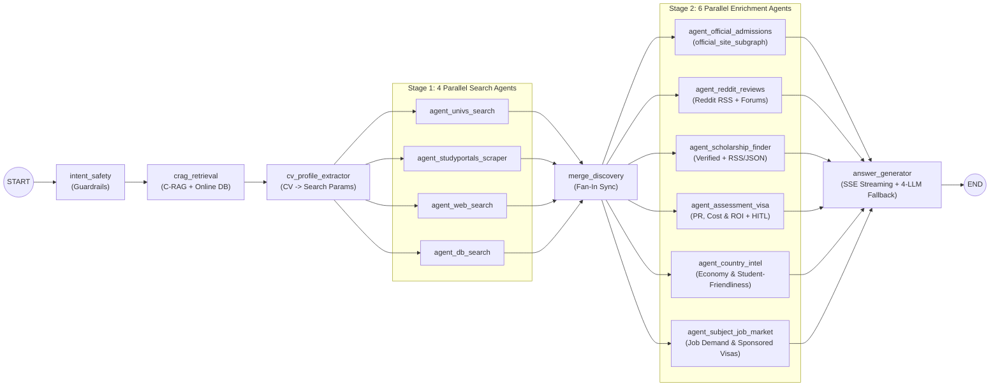

<div align="center">

# UniFinder AI — Multi-Agent Higher-Education, Scholarship & Immigration Intelligence

**An autonomous LangGraph multi-agent platform that turns a student's CV or study goals into verified university matches, live scraped admissions data, student reviews, scholarship opportunities, post-study work visa roadmaps, and career ROI forecasts.**

[](https://unifinder-multi-agent.onrender.com/)
[](https://www.python.org/)
[](https://fastapi.tiangolo.com/)
[](https://langchain-ai.github.io/langgraph/)
[](https://www.postgresql.org/)
[](LICENSE)

**[Live Application: unifinder-multi-agent.onrender.com](https://unifinder-multi-agent.onrender.com/)**

</div>

---

## Why UniFinder AI?

International students applying for **BSc, MSc, or PhD** degrees face fragmented data across university portals, scholarship feeds, visa rulebooks, and student forums. **UniFinder AI** solves this with a **dual-stage parallel LangGraph multi-agent architecture**:

- **Parallel Discovery**: Queries the **Univs.com Public Catalogue API** (22,900+ institutes), **StudyPortals**, **DuckDuckGo Web Intelligence**, and a **curated PostgreSQL/SQLite database** concurrently.
- **Official Website Admissions Subgraph**: A compiled LangGraph subgraph (`official_site_subgraph`) crawls target university websites to extract **tuition, IELTS/TOEFL minimums, GPA cutoffs, deadlines, intakes, and programs**.
- **CV-Driven Search & Corrective RAG (C-RAG)**: Upload a PDF/DOCX/TXT CV or transcript—chunks and extracted profile facts (`GPA`, `IELTS`, `Major`, `Skills`, `Recommended Degree`) persist in **online PostgreSQL** (`session_documents`) and automatically drive university & program search.
- **Attribution-Compliant Live Scholarships**: Combines **Verified Open** government portals with **Newly Discovered** records from **Worldwide Scholarships RSS** and **Open Scholarships JSON (CC-BY-4.0)**, preserving original links and attribution.
- **Resilient 4-Provider Free LLM Fallback**: Automatically cascades across **Groq → Google Gemini → Mistral AI → Cohere** on rate limits or failures.
- **Privacy-First Exit Wipe**: 1-to-1 chat thread & session binding with one-click **`End Chat & Wipe Data`** (or auto-wipe on tab exit) that purges threads, messages, CVs, shortlists, and LangGraph checkpoints.

---

## Multi-Agent Architecture



For a deep dive into state schemas, subgraphs, and database tables, see **[docs/ARCHITECTURE.md](docs/ARCHITECTURE.md)**.

---

## Key Features

| Capability | Implementation |
| :--- | :--- |
| **ChatGPT-Style Persistent Chat** | Multi-turn conversations persisted in PostgreSQL (`chat_messages` + `PostgresSaver`) with discreet SSE streaming. |
| **Parallel Search & Enrichment** | 4 parallel discovery agents + 6 parallel enrichment agents orchestrated natively in LangGraph. |
| **Official Site Scraper Subgraph** | Compiled 3-node `StateGraph` (`resolve_site` → `scrape_pages` → `extract_admissions`) using BeautifulSoup4. |
| **Live Scholarships & Policy News** | Distinguishes `✅ Verified Open` portals from `🆕 Newly Discovered` RSS/JSON feed posts with 15-min TTL caching. |
| **Career ROI & PR Pathways** | Calculates 3-year net ROI, tuition payback period, city living costs, and post-study sponsored visa rules. |
| **SOP Reviewer & Wishlist** | Evaluates Statement of Purpose drafts with cliché detection + persistent university shortlist CRUD. |

---

## Project Structure

```text
unifinder-multi-agent/
├── app.py                          # FastAPI server, REST APIs & SSE streaming
├── backend.py                      # LangGraph 15-node parallel workflow & 4-LLM fallback
├── database.py                     # Dual-mode PostgreSQL / SQLite persistence & exit wipe
├── guardrails.py                   # Prompt-injection guardrails, eligibility & HITL triggers
├── run.py                          # Interactive launcher with smart port fallback
├── test_app.py                     # End-to-end verification suite
├── requirements.txt                # Python dependencies
├── render.yaml & Procfile          # 1-click Render cloud deployment configs
├── DEPLOYMENT_RENDER.md            # Render + PostgreSQL deployment guide
├── docs/
│   └── ARCHITECTURE.md             # Deep-dive technical architecture documentation
├── tools/
│   ├── univs_tool.py               # Univs.com Public Catalogue REST API integration
│   ├── mastersportal_tool.py       # StudyPortals (Masters/Bachelors/PhD) scraper
│   ├── university_scraper_tool.py  # Official university site crawler & LangGraph subgraph
│   ├── reviews_tool.py             # Reddit RSS + forum student/alumni reviews extractor
│   ├── country_job_intel_tool.py   # Country economics & subject sponsored-visa intelligence
│   ├── scholarship_feeds_tool.py   # Worldwide Scholarships RSS + Open Scholarships JSON
│   ├── opportunities_tool.py       # Unified Verified Open & Newly Discovered scholarships
│   ├── rag_engine.py               # Online DB-backed C-RAG & CV profile extraction
│   ├── pr_visa_tool.py             # Post-study work permit & PR feasibility engine
│   ├── career_roi_tool.py          # Starting salary & tuition payback ROI calculator
│   ├── living_cost_tool.py         # City living costs & currency converter
│   ├── sop_reviewer_tool.py        # Statement of Purpose evaluator
│   └── web_intelligence.py         # DuckDuckGo live web search & page reader
├── templates/
│   └── index.html                  # Ghost White, Cool Gray & Freezing Blue dashboard
└── static/
    ├── style.css                   # Responsive UI design system
    └── script.js                   # ChatGPT-style SSE client & interactive controllers
```

---

## Quick Start

### 1. Clone & Install
```bash
git clone https://github.com/taosiff/unifinder-multi-agent.git
cd unifinder-multi-agent
pip install -r requirements.txt
```

### 2. Configure Environment
Copy `.env.example` to `.env` and add **at least one** free LLM key (add multiple for automatic failover):
```bash
cp .env.example .env
```
- `GROQ_API_KEY` — [console.groq.com/keys](https://console.groq.com/keys)
- `GOOGLE_API_KEY` — [aistudio.google.com/app/apikey](https://aistudio.google.com/app/apikey)
- `MISTRAL_API_KEY` — [console.mistral.ai/api-keys](https://console.mistral.ai/api-keys)
- `COHERE_API_KEY` — [dashboard.cohere.com/api-keys](https://dashboard.cohere.com/api-keys)
- `DATABASE_URL` *(Optional)* — PostgreSQL URL for cloud persistence (falls back to local SQLite automatically if omitted).

### 3. Run Locally
```bash
python run.py
```
Open **[http://127.0.0.1:8000](http://127.0.0.1:8000)**.

### 4. Deploy to Render (Free Tier)
See **[DEPLOYMENT_RENDER.md](DEPLOYMENT_RENDER.md)** for step-by-step instructions using `render.yaml` and free PostgreSQL.

---

## License

Released under the [MIT License](LICENSE).
