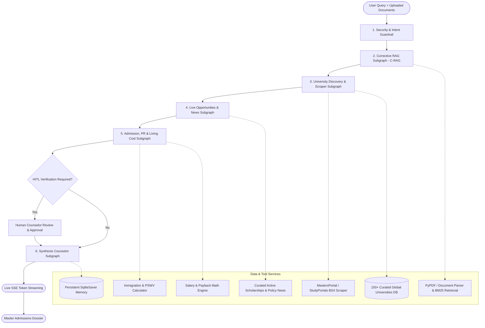

# 🎓 UniFinder AI — Higher-Ed, PR, Scholarships & C-RAG Matrix

> **An Autonomous Multi-Agent Intelligence System built with LangChain, LangGraph Subgraphs, SqliteSaver Persistent Memory, Corrective RAG (C-RAG), Real-Time SSE Streaming, Human-in-the-Loop (HITL), and LangSmith Observability.**
>
> **Designed in an Executive Luxury Navy (`#0B192C`), Warm Cream (`#FDFBF7`), and Vibrant Coral (`#FF6B6B`) Aesthetic.**

---

## 🌟 The Real-World Business Problem Solved
International students and graduate researchers seeking Bachelor's (BSc), Master's (MSc), or Doctoral (PhD) degrees face a fragmented, high-risk landscape:
1. **Scattered, Opaque Data**: Tuition fees, living expenses, and rankings are siloed across disconnected sites.
2. **Immigration Blindspots**: Students often enroll in degrees without understanding post-graduation work permit (PGWP/OPT) restrictions or permanent residency (PR) viability.
3. **Financial Miscalculations**: Hidden proof-of-funds mandates (e.g. German *Sperrkonto* €11,904, Canadian GIC $20,635 CAD) cause sudden visa refusals.
4. **Generic AI Hallucinations**: Standard chatbots give vague advice without analyzing the student's actual transcript, GPA, or regional immigration rules.

**UniFinder AI** solves this end-to-end by orchestrating a specialized LangGraph network of modular subgraphs that conduct live web scraping, evaluate uploaded transcripts/CVs with **Corrective RAG (C-RAG)**, enforce admission & financial safety guardrails, stream real-time tokens, and support **Human-in-the-Loop (HITL)** approvals.

---

## 🏗️ Multi-Agent Subgraphs Architecture (LangGraph)

UniFinder AI uses modular subgraphs with persistent checkpointing:



---

## 🚀 Key Wholesome Features & Modules

### 1. Persistent Multi-Turn Memory & Chat Threads (`SqliteSaver`)
- Persistent SQLite checkpointing (`unifinder_memory.db`) ensures conversations, state, and thread histories persist across server restarts.
- Sidebar with **Chat History**: Create new sessions, switch between past conversations, or delete old threads.

### 2. Corrective RAG (C-RAG) on Uploaded Documents
- **Direct Document Upload**: Upload academic transcripts, CV/resume, or university brochures (`.pdf`, `.docx`, `.txt`).
- **Automatic Profile Extraction**: Detects CGPA (e.g., 3.75/4.0), IELTS band (e.g., 7.5), and major, auto-populating student parameters.
- **Relevance Grading**: Evaluates retrieved chunks. If relevant, grounds answers directly in the student's transcript with source citations; if partial or missing, triggers fallback to live search and institutional databases.

### 3. Real-Time Token Streaming (Server-Sent Events)
- High-speed async generator streaming tokens and step transitions live to the UI (`/api/chat/stream`).
- Users see the multi-agent system reasoning and writing in real time with a blinking cursor.

### 4. Human-in-the-Loop (HITL) Checkpoints
- Automated triggers flag decisions requiring human counselor confirmation (e.g., if all matched programs fall into the "Reach" tier or if the budget requires external full-ride scholarships).
- Displays interactive approval banners with action options before locking application strategies.

### 5. Live Opportunities & Scholarships Feed
- **Active Programs**: Curated database of premier global awards: **DAAD EPOS (Germany), Erasmus Mundus (EU), Fulbright (USA), Chevening (UK), MEXT (Japan), CSC (China), Australia Awards, Eiffel (France), and Italian DSU**.
- **Regulatory News Feed**: Live immigration policy alerts (Canadian study permit caps, German Opportunity Card *Chancenkarte*, UK graduate route salary concessions, US 3-year STEM OPT extensions).

### 6. LangSmith Observability & Monitoring
- Native integration with **LangSmith** for full-stack LLM tracing, latency monitoring, and token analytics (`LANGCHAIN_TRACING_V2=true`).

---

## 🎨 Design System: Luxury Navy, Warm Cream & Vibrant Coral
- **Luxury Deep Navy** (`#0B192C`, `#132A4A`, `#1E3E62`): Navbar, sidebar, headers, data table titles.
- **Warm Cream** (`#FDFBF7`, `#F7F4EB`, `#FAF3E0`): Clean paper background, subtle card borders, neutral canvas.
- **Vibrant Coral** (`#FF6B6B`, `#FA5252`, `#E03131`): Action buttons, interactive sliders, progress stepper, highlights.

---

## 🔑 How to Generate Free Online LLM API Keys (30 Seconds)

UniFinder AI runs on **100% Free Online LLMs**:

### Option 1: Google Gemini API Key (Recommended)
1. Go to **[Google AI Studio](https://aistudio.google.com/app/apikey)**.
2. Sign in with any Google account & click **"Create API Key"**.
3. Copy the key (`AIzaSy...`) and paste it into `.env` or the web app's **"API Settings"** modal!

### Option 2: Groq Cloud API Key (Ultra-Fast)
1. Go to **[Groq Console](https://console.groq.com/keys)**.
2. Sign in & click **"Create API Key"**.
3. Copy the key (`gsk_...`) and paste it in!

---

## 💻 Quick Start & Run Instructions

### 1. Install Dependencies
```bash
pip install -r requirements.txt
```

### 2. Configure Keys (Optional)
Copy `.env.example` to `.env`:
```bash
cp .env.example .env
```
Add your free `GOOGLE_API_KEY`, `GROQ_API_KEY`, and optional `LANGCHAIN_API_KEY` for LangSmith tracing.

### 3. Start the Server
```bash
python run.py
```
Or with Uvicorn:
```bash
uvicorn app:app --host 127.0.0.1 --port 8000 --reload
```

### 4. Open in Browser
Visit **`http://127.0.0.1:8000`** to access the complete multi-agent system!
