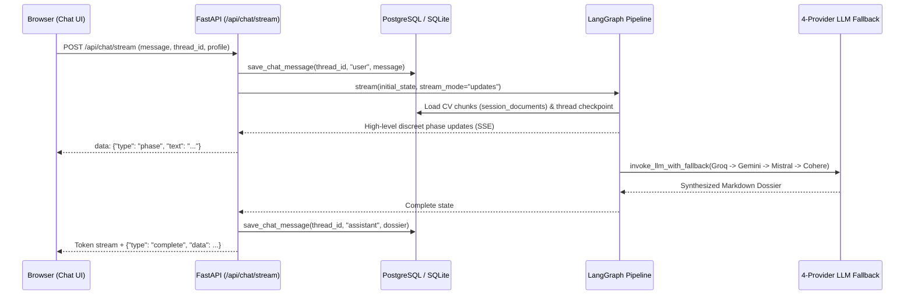

# Technical Architecture — UniFinder AI

This document details the multi-agent orchestration, state management, persistence layer, and safety mechanisms powering **UniFinder AI**.

---

## 1. End-to-End Request Lifecycle

---

## 2. LangGraph State & Parallel Execution

`UniFinderState` (`backend.py`) coordinates data across 15 nodes without write conflicts:
- **Sequential Entry**: `intent_safety` → `crag_retrieval` → `cv_profile_extractor`
- **Stage 1 Fan-Out (4 Parallel Search Agents)**:
  - `agent_univs_search` writes `univs_catalogue_results`
  - `agent_studyportals_scraper` writes `portal_scraping_result`
  - `agent_web_search` writes `web_search_results`
  - `agent_db_search` writes `discovered_universities`
- **Synchronization Barrier**: `merge_discovery`
- **Stage 2 Fan-Out (6 Parallel Enrichment Agents)**:
  - `agent_official_admissions` invokes compiled `official_site_subgraph` (`resolve_site` → `scrape_pages` → `extract_admissions`) and writes `official_admissions_scraped`
  - `agent_reddit_reviews` writes `university_reviews`
  - `agent_scholarship_finder` writes `active_opportunities`
  - `agent_assessment_visa` writes `eligibility_analysis`, `immigration_analysis`, `living_cost_details`, `career_roi_analysis`, and HITL flags
  - `agent_country_intel` writes `country_intel`
  - `agent_subject_job_market` writes `subject_job_market`
- **Stage 3 Synthesis**: `answer_generator` produces `dossier_markdown` incorporating follow-up conversation turns from `messages` (`Annotated[list[AnyMessage], operator.add]`).

---

## 3. Database Schema & Privacy Wipe (`database.py`)

| Table | Purpose | Cleaned on Session Exit? |
| :--- | :--- | :---: |
| `universities` | Curated global research university benchmarks | No (shared catalog) |
| `chat_threads` | Conversation thread metadata & timestamps | Yes |
| `chat_messages` | Persisted `user` and `assistant` chat turns | Yes |
| `session_documents` | Uploaded CV/transcript chunks & extracted profile JSON | Yes |
| `user_shortlists` | Saved wishlist universities & notes | Yes |
| `checkpoints` / `checkpoint_blobs` / `checkpoint_writes` | LangGraph `PostgresSaver` / `SqliteSaver` state | Yes |

Calling `POST /api/session/end` or `DELETE /api/threads/{thread_id}` invokes `purge_session_data()`, deleting all session-scoped rows across every table above and clearing in-memory caches.

---

## 4. API Endpoints Overview (`app.py`)

- `POST /api/chat/stream` — SSE streaming multi-turn counselor endpoint
- `POST /api/find` — Synchronous multi-agent dossier endpoint
- `POST /api/upload-doc` — Upload PDF/DOCX/TXT CV or transcript into online DB
- `GET /api/threads`, `GET /api/threads/{id}/messages`, `DELETE /api/threads/{id}` — Thread CRUD
- `POST /api/session/end` — Exit chat & cascade-purge all personal data
- `GET /api/opportunities` — Verified Open + Newly Discovered scholarships & visa news
- `GET /api/univs/programs`, `GET /api/univs/institutes`, `GET /api/univs/addresses` — Univs.com API proxy
- `POST /api/scrape-university` — On-demand `official_site_subgraph` execution
- `POST /api/review-sop` — Statement of Purpose rubric evaluator
- `GET /api/status`, `GET /health` — Database checkpointer & key readiness check
